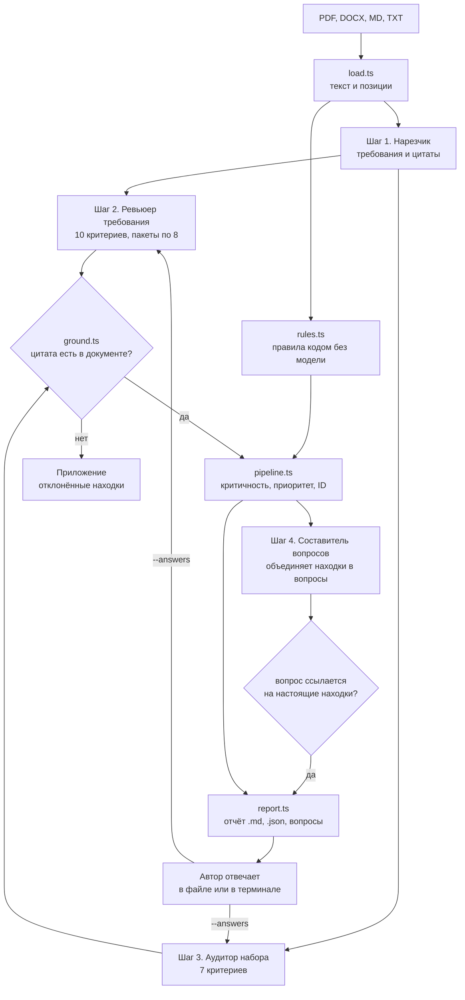

# Агент проверки требований

CLI-агент на Bun и TypeScript для статического ревью документа с требованиями до начала разработки. Агент читает документ (PDF, DOCX, Markdown или TXT), выделяет отдельные требования, проверяет каждое требование и весь набор по ISO/IEC/IEEE 29148:2018 (п. 5.2.5, 5.2.6) и IEEE Std 830-1998 (п. 4.3), а затем записывает отчёт на русском языке. По найденным дефектам агент составляет уточняющие вопросы к автору документа, принимает ответы и проверяет документ заново с их учётом.

Работа сделана для BCC-HUB x MNU FinTech Hackathon. Условие задачи лежит в [`docs/task.md`](docs/task.md), выданный организаторами документ лежит в [`docs/requirements.md`](docs/requirements.md).

README написан для человека, который будет поднимать и проверять агента. В нём описаны установка, настройка, команда прогона, устройство агента, способы проверить результат и известные ограничения.

## Содержание

1. [Что нужно для запуска](#1-что-нужно-для-запуска)
2. [Быстрый старт](#2-быстрый-старт)
3. [Ключ LLM и настройка `.env`](#3-ключ-llm-и-настройка-env)
4. [Команда и её контракт](#4-команда-и-её-контракт)
5. [Как агент проверяет документ](#5-как-агент-проверяет-документ)
6. [Состав отчёта](#6-состав-отчёта)
7. [Как проверить агента](#7-как-проверить-агента)
8. [Если что-то пошло не так](#8-если-что-то-пошло-не-так)
9. [Ограничения](#9-ограничения)
10. [Устройство кода](#10-устройство-кода)
11. [Соответствие условию задачи](#11-соответствие-условию-задачи)

## 1. Что нужно для запуска

| Что | Версия | Зачем |
| --- | --- | --- |
| [Bun](https://bun.sh) | 1.2 или новее, проверено на 1.4.5 | Запускает TypeScript без сборки, читает `.env`, ставит зависимости |
| git | любая | Агент пишет коммит в паспорт отчёта |
| Ключ Google Gemini API | бесплатный тариф | Модель, которая проверяет требования |
| Доступ в интернет | | Запросы к `generativelanguage.googleapis.com` |

Node.js не нужен. Bun ставится одной командой:

```bash
curl -fsSL https://bun.sh/install | bash      # macOS, Linux
powershell -c "irm bun.sh/install.ps1 | iex"   # Windows
bun upgrade                                    # если Bun уже стоит
```

## 2. Быстрый старт

```bash
git clone <ссылка на репозиторий>
cd <папка репозитория>

bun install                 # зависимости из bun.lock
cp .env.example .env        # затем впишите GEMINI_API_KEY в .env

bun start docs/requirements.md reports/check.report.md
```

Сданный отчёт лежит в `reports/requirements.report.md`. В примерах этого README свой прогон пишется в `reports/check.report.md`, чтобы не затереть сданный отчёт и чтобы два отчёта можно было сравнить.

Агент печатает ход работы в stderr: каждый шаг, его время и модель, каждую повторную попытку. Сданный отчёт агент сделал за 195 секунд. При перегрузке бесплатного тарифа Gemini прогон длится дольше: в наших прогонах 25 ноября до 80 минут, потому что модель часто не отвечала за 5 минут и агент повторял запрос (см. [раздел 7](#результаты-живых-прогонов)). В конце агент выводит итоговую строку. Для сданного отчёта она была такой:

```
Готово: reports/requirements.report.md. Требований: 46, нарушений: 57, критичных: 39, отклонено без цитаты: 0
```

Результат прогона:

- `reports/check.report.md` содержит отчёт для чтения;
- `reports/check.report.json` содержит те же данные в машинном виде: паспорт, итог (`verdict`), нарезку, все находки с позициями, вопросы и отклонённые находки;
- `reports/check.report.questions.md` содержит уточняющие вопросы к автору с пустыми строками «Ответ:» (см. [раздел 4](#уточняющие-вопросы-и-повторная-проверка)).

Без ключа и сети можно прогнать тесты: `bun test`. Подробнее в [разделе 7](#7-как-проверить-агента).

## 3. Ключ LLM и настройка `.env`

### Как получить ключ Gemini

1. Откройте https://aistudio.google.com/apikey и войдите аккаунтом Google.
2. Нажмите «Create API key», выберите или создайте проект и скопируйте ключ.
3. Впишите ключ в файл `.env` в корне проекта: `GEMINI_API_KEY=AIza...`.

Bun сам читает `.env` из текущей папки, поэтому запускайте команду из корня проекта. Файл `.env` указан в `.gitignore` и в репозиторий не попадает. Переменные можно передать и через окружение, они важнее значений из `.env`:

```bash
GEMINI_API_KEY=AIza... bun start docs/requirements.md
```

### Переменные

| Переменная | По умолчанию | Значение |
| --- | --- | --- |
| `LLM_PROVIDER` | `gemini` | `gemini`, `openai` (любой OpenAI-совместимый API) или `fixture` (только для тестов) |
| `GEMINI_API_KEY` | | Ключ Google AI Studio |
| `GEMINI_MODEL` | `gemini-3.6-flash,gemini-3.5-flash-lite` | Модель или список моделей через запятую. Первая основная, остальные резервные |
| `OPENAI_BASE_URL` | `https://api.openai.com/v1` | Адрес OpenAI-совместимого API, например `http://localhost:11434/v1` для Ollama |
| `OPENAI_API_KEY` | пусто | Ключ OpenAI-совместимого API. Для Ollama не нужен |
| `OPENAI_MODEL` | | Модель или список через запятую |
| `FIXTURE_DIR` | | Папка с записанными ответами для `LLM_PROVIDER=fixture` |

### Какую модель выбрать

По умолчанию стоит цепочка `gemini-3.6-flash,gemini-3.5-flash-lite`. Агент начинает с первой модели. Если она пять раз подряд отвечает 503 (перегрузка), 429 (лимит в минуту) или не отвечает за 5 минут, агент переключается на следующую и продолжает с ней до конца прогона. Если модель отвечает 429 с исчерпанной дневной квотой, агент переключается сразу, без повторов. Какая модель ответила на какой шаг, записано в паспорте отчёта.

Отчёт `reports/requirements.report.md` в репозитории сделан моделью `gemini-3.6-flash`. Flash находит больше дефектов, которые видны только при сопоставлении разных частей документа, чем Flash-Lite. Например, только Flash заметила, что критерий приёмки про покупку 31 января противоречит правилу Ф-2. Зато на бесплатном тарифе Flash чаще бывает перегружена, и тогда прогон уходит на Flash-Lite. Чтобы прогон шёл только на одной модели, укажите её без запятых: `GEMINI_MODEL=gemini-3.6-flash`. Модели `gemini-3.8-flash` нет в цепочке по умолчанию: 25 ноября 2026 года на нашем ключе она на все запросы отвечала 503.

### Квота бесплатного тарифа

На бесплатном тарифе у каждой модели есть лимит 20 запросов в день на проект Google Cloud (`GenerateRequestsPerDayPerProjectPerModel-FreeTier`) и лимит запросов в минуту. Один прогон выданного документа без повторов делает от 9 до 10 запросов: нарезка, 6 или 7 пакетов проверки по 8 требований, проверка набора и вопросы. Повторы добавляют запросы: прогон 26 ноября при перегрузке Gemini сделал 30. Значит, на одном проекте помещается один прогон в день на модель, при спокойной нагрузке два. Ключи из одного проекта делят одну квоту. Чтобы получить больше прогонов, возьмите ключ из другого проекта или включите оплату. Шаги, которые уже прошли, лежат в кэше, и повторный запуск не тратит на них квоту.

## 4. Команда и её контракт

```
bun start <файл требований> [файл отчёта] [--no-cache] [--answers <файл>] [--ask] [--json]
```

`bun start` запускает `bun run src/cli.ts`. Обе формы равнозначны.

| Аргумент | Обязателен | Значение |
| --- | --- | --- |
| `<файл требований>` | да | `.pdf`, `.docx`, `.md`, `.markdown` или `.txt` |
| `[файл отчёта]` | нет | Путь к Markdown-отчёту. По умолчанию `reports/<имя входного файла>.report.md`. Папки создаются сами. JSON пишется рядом с тем же именем и расширением `.json` |
| `--no-cache` | нет | Спросить модель заново, не беря ответы из кэша. Новые ответы всё равно сохраняются в кэш |
| `--answers <файл>` | нет | Файл вопросов с заполненными строками «Ответ:». Агент передаёт ответы модели как дополнения к документу и проверяет документ заново |
| `--ask` | нет | После прогона задать вопросы в терминале, сохранить ответы и предложить повторную проверку с ними |
| `--json` | нет | Напечатать в stdout одну строку JSON со сводкой прогона или с ошибкой (см. [запуск из скрипта](#запуск-из-скрипта-или-другим-агентом)) |
| `-h`, `--help` | нет | Справка |

Коды выхода:

| Код | Когда |
| --- | --- |
| 0 | Отчёт записан |
| 1 | Сбой прогона: модель недоступна после всех повторов, сеть, неверный ключ |
| 2 | Ошибка ввода: нет файла, неподдерживаемый формат, PDF без текстового слоя, не задан ключ, неверные аргументы |

### Уточняющие вопросы и повторная проверка

Каждый прогон пишет рядом с отчётом файл `<отчёт>.questions.md`. В нём до 20 вопросов к автору документа, по одному на группу дефектов, которые снимает один ответ. У вопроса есть адресат, причина, варианты ответа, место в документе и пустая строка «Ответ:». Ответить можно двумя способами.

В файле. Впишите ответы после «Ответ:» и запустите команду, которую агент печатает в конце прогона:

```bash
bun start docs/requirements.md reports/check.report.md --answers reports/check.report.questions.md
```

В терминале:

```bash
bun start docs/requirements.md reports/check.report.md --ask
```

С флагом `--ask` агент после прогона задаёт вопросы по одному. Enter пропускает вопрос, цифра выбирает вариант ответа, «q» завершает опрос. Агент сохраняет ответы в файл вопросов и спрашивает, проверить ли документ заново. Повторная проверка стоит столько же запросов, сколько первая.

При повторной проверке ответы попадают в промпты шагов 2 и 3 как дополнения к документу. Модель не сообщает о дефекте, который закрыл ответ, и сообщает, если ответ сам неполон или противоречит документу. Цитаты по-прежнему ищутся только в документе. Отчёт показывает учтённые ответы в разделе 7, а паспорт показывает число ответов. Файл вопросов переписывается вопросами нового прогона, поэтому ответы агент сохраняет отдельно в `<отчёт>.answers.md`.

### Запуск из скрипта или другим агентом

Без `--ask` агент ничего не спрашивает. Ход работы идёт в stderr, а stdout остаётся пустым. С флагом `--json` агент в конце печатает в stdout одну строку JSON:

```bash
bun start docs/requirements.md reports/check.report.md --json 2>/dev/null | jq '{decision, canStart, critical}'
```

| Поле | Значение |
| --- | --- |
| `ok` | `true`, если отчёт записан |
| `report`, `json`, `questionsFile` | Пути к отчёту, к его JSON и к файлу вопросов |
| `rerun` | Команда повторной проверки с ответами из файла вопросов |
| `decision` | `no`: есть критичные дефекты или нет требований; `incomplete`: модель не проверила часть требований; `with_reservations`: только некритичные нарушения; `yes`: нарушений нет |
| `canStart` | `true` для `yes` и `with_reservations`. Это тот же итог, что в разделе 6 отчёта |
| `requirements`, `violations`, `critical`, `rejected` | Число требований, нарушений, критичных нарушений и отклонённых находок без цитаты |
| `unchecked` | Требования, которые модель не проверила |
| `questions` | Вопросы автору: `id`, `addressee`, `critical`, `question`, `options` |

При ошибке строка выглядит так: `{"ok":false,"exitCode":2,"error":"Файл не найден: missing.md"}`. Код выхода тот же, что без `--json`. Поле `verdict` с теми же значениями есть и в JSON-файле рядом с отчётом.

Чтобы другой агент ответил на вопросы, он вписывает ответы в строки «Ответ:» файла `questionsFile` и выполняет команду из `rerun`.

### Кэш ответов

Каждый успешный ответ модели агент сохраняет в `.cache/llm/`. Ключ кэша состоит из SHA-256 от провайдера, модели, полного текста промпта и схемы ответа. Если прогон упал на середине, например из-за перегрузки Gemini, повторный запуск возьмёт готовые шаги из кэша и спросит модель только о недостающих. Любое изменение документа, промпта или модели даёт новый ключ, поэтому устаревший ответ не подставится.

Число шагов из кэша агент пишет в паспорт отчёта. Для независимого прогона используйте `--no-cache`. С этим флагом агент спрашивает модель заново, но новые ответы сохраняет. Если такой прогон упадёт, запустите команду ещё раз без `--no-cache`, и агент продолжит с места сбоя.

Отчёт в репозитории сделан свежим прогоном с `--no-cache` на закоммиченном коде, без ответов из кэша. Папка `.cache/` указана в `.gitignore`, поэтому в клоне репозитория кэша нет и первый прогон всегда идёт к модели. Свежий прогон того же документа даёт близкий, но не тот же список находок.

## 5. Как агент проверяет документ

### Архитектура

Агент состоит из четырёх ролей LLM и детерминированного кода вокруг них. Модель предлагает: нарезку, находки, вопросы. Код проверяет и решает: ищет каждую цитату в документе, отбрасывает находки и вопросы без опоры на текст, считает критичность и итог. Поэтому в отчёте нет нарушения без места в документе и нет вывода, который модель могла бы придумать.



| Роль | Где | Что получает | Что возвращает | Что проверяет код |
| --- | --- | --- | --- | --- |
| Нарезчик | шаг 1, `extractPrompt` | Весь документ | Требования с номером документа, разделом, типом и цитатой | Цитата найдена в документе, иначе место «не найдено» |
| Ревьюер требования | шаг 2, `checkPrompt` | Документ, пакет из 8 требований, ответы автора | Находки по 10 критериям с цитатой, исправлением и вопросом | ID требования известен, цитата найдена, пропущенные требования переспрашиваются один раз |
| Аудитор набора | шаг 3, `setPrompt` | Документ, нарезка, ответы автора | Находки по 7 критериям набора с цитатами всех мест | Хотя бы одна цитата найдена, ID требований известны |
| Составитель вопросов | шаг 4, `questionsPrompt` | Документ и все принятые находки | До 20 вопросов с адресатом, причиной и вариантами | Вопрос ссылается на существующие находки, место и приоритет берутся из них |
| Правила кодом | после шага 3, `src/rules.ts` | Текст документа | Находки набора с цитатами, без запроса к модели | Находка попадает в отчёт, только если модель не нашла того же дефекта на тех же строках |
| Надёжность | `src/llm.ts` | Каждый запрос | | Резервная модель, срок 5 минут, повторы, дневная квота, кэш и продолжение после сбоя |

Почему так, а не один большой промпт. Каждая роль решает одну задачу со своей схемой ответа, и код может проверить её результат отдельно. Пакеты по 8 требований дают модели проверить каждое требование по каждому критерию: при одном запросе на весь документ модель пропускает требования. Решения о критичности и итоге в коде, потому что модель в разных прогонах оценивает одно и то же по-разному, а правило в коде одинаково всегда. Жёсткий фреймворк из нескольких агентов условие не требует. Агент последовательно вызывает модель и обходится без зависимостей сверх клиента Gemini.

### Чтение документа

- PDF читается через `unpdf` (PDF.js) постранично. Страницы склеиваются через символ `\f`, поэтому место находки пересчитывается в «с. 2, строка 14». Сканы без текстового слоя агент не распознаёт и завершает работу с кодом 2.
- DOCX читается через `mammoth` как текст. Место указывается как номер абзаца, потому что Word не показывает номера строк.
- Markdown и TXT читаются как есть. Место указывается как номер строки файла.

### Шаг 1. Нарезка

Модель получает весь документ и возвращает список требований: идентификатор в документе (например «Ф-1») или `null`, раздел, тип, краткую формулировку и дословную цитату. Правила нарезки заданы в `src/prompts.ts`:

- пронумерованные пункты остаются целыми и сохраняют номер документа;
- ненумерованный текст (цели, UI, НФТ, данные, интеграция, строки критериев приёмки, шаги логики API, параметры, коды ответа) делится на отдельные требования;
- примеры JSON, curl, пустой чек-лист ревью и блок подписей не считаются требованиями.

Агент присваивает каждому требованию свой номер `ТР-01`, `ТР-02` и так далее в порядке документа. Модель при этом видит ASCII-ключи `R1`, `R2`. Так модель не может перепутать кириллицу `ТР` с латиницей `TP`, а агент сопоставляет ответ с требованием без ошибок.

### Шаг 2. Проверка каждого требования

Требования уходят модели пакетами по 8 вместе с полным текстом документа. Полный текст нужен, чтобы модель видела критерии приёмки, диаграммы и дочернюю спецификацию. Каждое требование проверяется по 10 критериям:

| Критерий | Источник |
| --- | --- |
| Необходимость | 29148 5.2.5 a |
| Уместность уровня (нет лишних проектных решений) | 29148 5.2.5 b |
| Однозначность | 29148 5.2.5 c; 830 4.3.2 |
| Полнота | 29148 5.2.5 d; 830 4.3.3 |
| Единичность | 29148 5.2.5 e |
| Выполнимость | 29148 5.2.5 f |
| Проверяемость | 29148 5.2.5 g; 830 4.3.6 |
| Корректность | 29148 5.2.5 h; 830 4.3.1 |
| Соответствие шаблону | 29148 5.2.5 i |
| Трассируемость | 830 4.3.8 |

Промпт задаёт приёмы ревью: подставить граничные значения, попытаться написать тест, сверить единицы и типы одного поля во всех разделах, пересчитать критерий приёмки по правилу. Промпт не содержит подсказок о дефектах конкретного документа.

Если модель пропустила требование в ответе, агент один раз переспрашивает о пропущенных. Требование, которое модель не оценила и после этого, помечается в отчёте как «не проверено», а не как чистое. В этом случае итог не может быть положительным.

### Шаг 3. Проверка набора

Модель получает весь документ и нарезку и проверяет набор по 7 критериям: полнота (29148 5.2.6 a), непротиворечивость (5.2.6 b), выполнимость (5.2.6 c), понятность (5.2.6 d), валидируемость (5.2.6 e), ранжированность (830 4.3.5), модифицируемость (830 4.3.7). Для противоречия модель приводит цитаты обоих мест.

Дефекты, которые нашли правила в коде (ниже) и не нашёл шаг 2, идут в промпт шага 3 списком «уже найдено кодом», чтобы модель не повторяла их и искала остальное.

После модели код прогоняет по тексту документа правила из `src/rules.ts`. Они не обращаются к модели и дают одинаковый результат в каждом прогоне:

| Правило | Что ищет |
| --- | --- |
| `money-units` | Одна валюта в двух единицах (тенге и тиын, рубль и копейка) без указанного пересчёта |
| `field-types` | Одно поле с типами разного рода в разных таблицах, например integer и string |
| `mutating-get` | Метод GET, путь или описание которого говорит об изменении данных |
| `json-without-body` | Content-Type application/json рядом с фразой, что тела у запроса нет |
| `status-section` | Раздел ответа с одним кодом, в тексте которого возвращается другой код |
| `error-in-success` | Пример ответа с ошибкой в разделе успешного кода 2xx |
| `empty-values` | Пустые значения («Prod: —», строка таблицы с «—») и пометки «не заполнен», «TBD» |

Правило добавляет находку, только если модель не нашла того же: находка модели на пересекающихся строках, текст которой называет тот же предмет, считается тем же дефектом. В отчёте такие находки помечены «найдено кодом». Правила читают таблицы и заголовки Markdown, поэтому на PDF и DOCX работают только правила по строкам текста.

Правила записаны как общие шаблоны, но придуманы при разборе выданного документа. Поэтому их вклад в `bun run recall` ожидаем заранее и сам по себе ничего не доказывает. На прогонах 25 и 26 ноября правила добавили бы к находкам Flash только `money-units`, а к находкам Flash-Lite ещё и `error-in-success`: остальное модели находили сами. Тесты в `test/rules.test.ts` проверяют каждое правило на выдуманном документе про заказы и то, что правила молчат на согласованном документе.

### Шаг 4. Уточняющие вопросы

Каждая находка шагов 2 и 3 уже содержит черновой вопрос автору. Шаг 4 отправляет модели все принятые находки с ключами `F1`, `S1` и получает не больше 20 вопросов. Модель объединяет находки, на которые отвечает один ответ, называет адресата (бизнес, аналитик, архитектор, тестирование, безопасность) и объясняет, что будет по-разному у разработчика и тестировщика при разных ответах. Варианты ответа — это разные прочтения процитированного места, а для противоречия — «как в первом месте», «как во втором», «оба при условии». Так устроен выбор вариантов в ClarifyGPT ([arXiv:2310.10996](https://arxiv.org/abs/2310.10996)). Находки, которые аналитик исправит сам без автора, например оформление, в вопросы не попадают. Нижней границы числа вопросов нет, чтобы модель не добавляла вопросы ради числа.

Код принимает только вопросы, которые ссылаются на существующие находки. Места, требования и приоритет вопроса код берёт из этих находок, вопрос по критичной находке идёт раньше. Среди вопросов одного уровня раньше идёт тот, чей ответ закрывает больше: код складывает серьёзность его находок (высокая 3, средняя 2, низкая 1), но не больше трёх, чтобы вопрос не поднимался только за счёт числа мелких находок. Вопрос без ссылки агент отбрасывает и пишет об этом в лог. Если шаг 4 не удался, прогон не падает: отчёт получает вопросы критичных находок без объединения и пометку об этом. В конце прогона агент печатает пять главных вопросов.

### Привязка к тексту

Условие задачи требует, чтобы каждое нарушение ссылалось на конкретное место. Агент проверяет это в коде, промпт для этого не используется:

1. Модель обязана дать дословную цитату для каждой находки.
2. `src/ground.ts` ищет цитату в тексте документа. Поиск не учитывает регистр, пробелы и переносы строк, разметку Markdown (`*`, `` ` ``, `|`, `#`, `_`), виды кавычек, виды тире и букву «ё». Маркеры списков из DOCX (`•`) тоже не учитываются. Дефис между буквой и концом строки считается переносом слова и не учитывается, а тире в конце строки («Prod: —») остаётся. Цитата с многоточием находится, если все её части стоят в документе по порядку.
3. Найденная позиция пересчитывается в строку, страницу или абзац. Это место агент пишет в отчёт.
4. Находка, цитаты которой нет в документе, не попадает в подсчёты и выводы. Агент переносит её в приложение «Отклонённые находки», чтобы проверяющий видел, что модель предлагала.

### Критичность и итог

Подсчёты, список критичных дефектов и итог считает код (`src/pipeline.ts`, `src/report.ts`), модель в этом не участвует.

- Модель ставит каждой находке серьёзность: высокая, средняя или низкая.
- Критичной агент считает находку с высокой серьёзностью, а также находку со средней серьёзностью по проверяемости, полноте или непротиворечивости. Это три вида дефектов, которые условие задачи называет критичными.
- Итог «Нет, начинать нельзя» ставится, если есть хотя бы один критичный дефект. «Можно, с оговорками» ставится, если есть только некритичные. «Да» ставится, если нарушений нет. «Нет, проверка неполная» ставится, если модель не оценила часть требований.
- В разделе «Что исправить в первую очередь» стоят до 10 критичных дефектов, отсортированных по серьёзности, с предложением модели, как их исправить.

### Повторы и таймауты

- Ответы 429, 5xx, таймаут и обрыв сети агент повторяет с паузой 5, 10, 20, 40, 60 секунд. На каждой модели, кроме последней, делается до 5 попыток, на последней до 8.
- На каждый запрос стоит жёсткий срок 5 минут. Если модель не ответила, агент обрывает соединение через `AbortController`, пишет в лог «нет ответа за 300 с» и повторяет запрос. Срок работает, даже если SDK не реагирует на свой таймаут: в одном из прогонов запрос без этого срока висел 55 минут. После двух таких обрывов на одной модели шаг переходит к следующей модели цепочки, потому что зависший запрос, скорее всего, уже засчитан в дневную квоту. На последней модели обрыв повторяется до 8 раз.
- У шага вопросов не больше 3 попыток на модель. Если шаг не удался, вопросы собираются из находок, поэтому тратить на него квоту так же, как на проверку, незачем.
- Ответ 429 с исчерпанной дневной квотой (в тексте ошибки есть `PerDay`) не повторяется на той же модели. Агент сразу переходит к следующей модели, а если её нет, завершает прогон с кодом 1 и подсказкой, что делать.
- Невалидный JSON или ответ не по схеме агент тоже повторяет и сообщает модели текст ошибки схемы.
- Ответы 400 и 403 (неверный ключ, неизвестная модель) не повторяются, прогон сразу завершается с кодом 1.
- Встроенные повторы SDK Gemini выключены, чтобы они не умножались на повторы агента.

Температура модели 0.1, ответ принимается только как JSON по схеме: `responseJsonSchema` у Gemini, `response_format: json_object` у OpenAI-совместимых API. Каждый ответ агент проверяет через zod.

## 6. Состав отчёта

| Раздел отчёта | Что внутри | Пункт условия (§6) |
| --- | --- | --- |
| 1. Паспорт прогона | Название документа, файл, SHA-256 файла, дата и часовой пояс, длительность, провайдер, модель по шагам, число запросов к API и шагов из кэша, версия агента (`git describe` и пометка о незакоммиченных изменениях), стандарты | Паспорт прогона |
| 2. Как агент нарезал требования | Таблица: ID в отчёте, ID в документе, тип, раздел, место, краткая формулировка, цитата | Как агент нарезал требования |
| 3. Проверка каждого требования | Матрица «требование × 10 критериев» и для каждого требования таблица нарушений: критерий, серьёзность, место, цитата, суть, как исправить | Проверка каждого требования |
| 4. Проверка всего набора | Итог по каждому из 7 критериев набора и находки с цитатами всех затронутых мест | Проверка всего набора |
| 5. Сводка | Число требований, нарушений, разбивка по серьёзности и критериям, таблица критичных дефектов | Сводка |
| 6. Итог | Можно ли начинать разработку и тестирование, что исправить в первую очередь и сколько вопросов к автору | Итог |
| 7. Уточняющие вопросы | Таблица вопросов, затем каждый вопрос с адресатом, причиной, вариантами, местами и находками. После `--answers` таблица учтённых ответов | Критерий жюри «Уточнение» |
| Приложение | Находки, которые агент отклонил, потому что их цитат нет в документе | |

## 7. Как проверить агента

### Тесты без ключа и сети

```bash
bun test            # 32 теста в 5 файлах: привязка цитат, PDF, DOCX, повторы, срок ответа, дневная квота, резервная модель, кэш, сквозной прогон CLI, вопросы и ответы, коды выхода, вывод --json, правила кодом, сверка с известными дефектами
bun run typecheck   # tsc --noEmit
```

Сквозные тесты запускают настоящий CLI с `LLM_PROVIDER=fixture`. В этом режиме агент вместо модели читает записанные ответы из `test/fixtures/llm/` для маленького документа `test/fixtures/sample.md` и его PDF-версии `sample.pdf`. В фикстурах специально есть ошибки модели: цитата, которой нет в документе, неизвестный ID требования, пропущенное требование и вопрос со ссылкой на несуществующую находку. Отдельные тесты проверяют возврат ответов через `--answers` и запасной список вопросов, если шаг 4 не удался. Тесты проверяют, что агент их отклоняет или помечает. Отчёт в режиме фикстур начинается с пометки «Тестовый прогон» и для сдачи не годится.

Прогнать фикстуры вручную:

```bash
LLM_PROVIDER=fixture FIXTURE_DIR=test/fixtures/llm bun start test/fixtures/sample.md /tmp/sample.report.md
```

### Настоящий прогон

```bash
bun start docs/requirements.md reports/check.report.md --no-cache
```

Что посмотреть в отчёте:

1. **Паспорт.** В нём модель, дата и коммит. Если версия содержит «незакоммиченные изменения», отчёт сделан не на закоммиченном коде.
2. **Цитаты настоящие.** Возьмите любую цитату из отчёта и найдите её в `docs/requirements.md`, например так: `grep -n "в течение минуты" docs/requirements.md`. Номер строки должен совпасть с колонкой «Место».
3. **Нарезка полная.** Сверьте раздел 2 с документом: все Ф-1…Ф-4, НФТ, требования к данным и интеграции, строки критериев приёмки, правила и параметры API.
4. **JSON совпадает с отчётом.** Например, `jq '.findings | length' reports/check.report.json` равно числу в строке «В отдельных требованиях» раздела 5.
5. **Отклонённые находки.** Если приложение есть, его цитат в документе действительно нет.
6. **Сравнение со сданным отчётом.** Сравните разделы 5 и 6 своего отчёта с `reports/requirements.report.md`. Числа будут отличаться, потому что модель недетерминирована, но главные дефекты должны совпасть: GET для сохранения, ответ 200 с `result: ERROR`, код 404 в разделе про 403. Противоречие критерия приёмки про 31 января правилу Ф-2 обычно находит только Flash, поэтому посмотрите в паспорте, какая модель отвечала.

### Результаты живых прогонов

Все прогоны сделаны на бесплатном тарифе Gemini. Модель каждого прогона указана в таблице. По паспортам отчётов в каждом прогоне эта модель ответила на все шаги, переключений на резервную модель не было. Отчёты повторных прогонов не входят в репозиторий, в нём лежит только сданный отчёт.

| Прогон | Модель | Коммит | Требований | Нарушений | Критичных | Без места | Отклонено | Длительность |
| --- | --- | --- | --- | --- | --- | --- | --- | --- |
| MD, сданный отчёт | `gemini-3.6-flash` | 6878a5f | 46 | 57 | 39 | 0 | 0 | 195 с |
| MD, повтор | `gemini-3.6-flash` | f2f04d8 | 48 | 63 | 41 | 0 | 1 | 4761 с |
| PDF из `cupsfilter` | `gemini-3.6-flash` | f2f04d8 | 50 | 62 | 38 | 0 | 0 | 940 с |
| DOCX из Word | `gemini-3.6-flash` | f2f04d8 | 44 | 51 | 37 | 4 | 5 | 4086 с |
| DOCX, ответы из кэша, исправленный поиск цитат | `gemini-3.6-flash` | после f2f04d8 | 44 | 56 | 41 | 0 | 0 | 0 запросов к API |
| MD, с шагом вопросов | `gemini-3.5-flash-lite` | 99df315 | 56 | 62 | 28 | 0 | 0 | 464 с |
| MD, правила кодом и новый промпт вопросов | `gemini-3.5-flash-lite` | 84ea441 | 50 | 66 | 37 | 0 | 0 | 71 с, шаги 1 и 2 из прогона на 0a13849 с теми же промптами |

Что видно из прогонов:

- Число требований и критичных нарушений между прогонами на `gemini-3.6-flash` отличается на 10 до 15 процентов, число нарушений до 25 процентов, потому что модель недетерминирована. Главные дефекты документа находятся во всех прогонах на этой модели: GET для сохранения, ответ 200 с `result: ERROR`, код 404 в разделе про 403, противоречие Ф-3 и Ф-4, противоречие критерия приёмки про 31 января правилу Ф-2.
- Долгие прогоны вызваны перегрузкой Gemini, а не агентом. За прогоны 25 ноября агент повторил запросы 26 раз. Из них 9 из-за 429, 6 из-за 503, 6 из-за «нет ответа за 300 с», 3 из-за закрытого сокета, 2 из-за обрыва.
- В прогоне DOCX 4 требования остались без места, а 5 находок попали в отклонённые. Причин было две: тире в конце строки («Prod: —») удалялось как перенос слова, а маркеры списков `•` мешали совпадению. Поиск цитат исправлен, и повтор того же прогона из кэша нашёл все цитаты. Тест на этот случай есть в `test/ground.test.ts`.
- Единственная отклонённая находка в повторе MD правильно отклонена. Модель склеила в цитате две строки таблицы, пропустив строку между ними.
- `gemini-3.8-flash` 25 ноября весь день отвечала 503 или сообщала, что квоты нет.
- 26 ноября `gemini-3.6-flash` отвечала 503, и все шаги прогона с шагом вопросов ответила `gemini-3.5-flash-lite`. Её результат отличается от Flash сильнее, чем прогоны Flash между собой: 56 требований вместо 44 до 50 и 28 критичных вместо 37 до 41. Flash-Lite не нашла противоречий Ф-2 с критерием приёмки про 31 января и Ф-3 с Ф-4. Шаг вопросов на Flash-Lite дал 16 вопросов, каждый с местом в документе и адресатом, например «Метод выполняет сохранение настроек или их чтение? Почему при сохранении используется метод GET?».

### Сверка с известными дефектами

В `eval/requirements.known.ts` записаны 12 дефектов выданного документа, которые видны при чтении: GET для сохранения, ответ 200 с `result: ERROR`, код 404 в разделе про 403, противоречия Ф-3 с Ф-4 и Ф-2 с критерием приёмки про 31 января, единицы тиын и тенге, типы `amount` и `enabled`, JSON без тела, пустой Prod URL, пустые версия и чек-лист, критерии приёмки без Ф-4. Промпты этот список не видят, он нужен только для оценки агента. Находка засчитывается дефекту, если её цитата взята из нужного места документа и текст нарушения называет суть дефекта.

```bash
bun run recall                                   # reports/requirements.report.json
bun run recall reports/check.report.json         # свой прогон
```

Команда печатает таблицу «дефект, найден, какими находками, какие вопросы автору его касаются» и не обращается к модели. Вопрос касается дефекта, если ссылается на одну из совпавших находок. Если рядом с отчётом лежит файл разметки `<отчёт>.labels.json` вида `{"ТР-19/appropriate": true, "Н-03": false}`, команда считает ещё и точность: долю верных находок среди размеченных.

| Отчёт | Модель | Найдено |
| --- | --- | --- |
| Сданный отчёт | `gemini-3.6-flash` | 11 из 12 |
| Прогон 26 ноября с шагом вопросов | `gemini-3.5-flash-lite` | 7 из 12 |
| Прогон 27 ноября, правила кодом и новый промпт вопросов | `gemini-3.5-flash-lite` | 9 из 12 |

Вопросы прогона Flash-Lite 26 ноября касаются 5 из 12 известных дефектов, вопросы прогона 27 ноября 7 из 12. Прибавку в найденных дефектах дали правила кодом: несогласованность тиынов и тенге и пустые версия и дата. Оба прогона 26 ноября пропустили несогласованность тиынов и тенге, теперь её находит правило `money-units`. Flash-Lite, кроме того, пропустила оба противоречия между разделами, пустые версию и чек-лист и пробелы в критериях приёмки. Поэтому в цепочке по умолчанию Flash стоит первой.

DOCX для прогона собран из `docs/requirements.md` так же, как это делает Word: Markdown в HTML через `bunx marked@15.0.12`, затем HTML в DOCX через `textutil`. В таком файле настоящие таблицы и списки Word.

### Другие форматы

Агент принимает тот же документ в PDF и DOCX. Чтобы получить их из Markdown:

```bash
# macOS
cupsfilter -i text/plain docs/requirements.md > /tmp/requirements.pdf
textutil -convert docx -output /tmp/requirements.docx docs/requirements.md
# любая ОС с pandoc
pandoc docs/requirements.md -o /tmp/requirements.docx

bun start /tmp/requirements.pdf /tmp/requirements-pdf.report.md
```

В отчёте по PDF места указаны как «с. N, строка M», по DOCX как «абзац N».

### Ошибки ввода

```bash
bun start                       # справка, код 2
bun start nope.pdf              # «Файл не найден», код 2
bun start package.json          # «Формат .json не поддерживается», код 2
GEMINI_API_KEY= bun start docs/requirements.md   # «Не задан GEMINI_API_KEY», код 2
```

## 8. Если что-то пошло не так

| Симптом | Причина и что делать |
| --- | --- |
| `503 This model is currently experiencing high demand` | Бесплатный тариф перегружен. Агент повторит запрос сам и перейдёт к резервной модели. Если упали все модели, запустите ту же команду ещё раз: готовые шаги возьмутся из кэша |
| `429` / `RESOURCE_EXHAUSTED` в логе повторов | Исчерпан лимит запросов в минуту. Агент подождёт и повторит запрос сам |
| `Исчерпана дневная квота модели` | Модель израсходовала 20 запросов в день на проект. Добавьте в `GEMINI_MODEL` другую модель, возьмите ключ из другого проекта Google Cloud или дождитесь сброса квоты. Повторный запуск продолжит с места сбоя (см. [квоту](#квота-бесплатного-тарифа)) |
| `нет ответа за 300 с` в логе повторов | Модель не ответила за 5 минут. Агент оборвал запрос и повторит его сам. Если так падают все попытки, Gemini перегружен, запустите прогон позже |
| `400 API key not valid` | Ключ скопирован не полностью или с пробелом. Проверьте `.env` |
| `404 models/... is not found` | Модели нет в вашем регионе или она снята. Список доступных моделей: https://ai.google.dev/gemini-api/docs/models |
| `Не задан GEMINI_API_KEY`, хотя `.env` есть | Команда запущена не из корня проекта. Bun читает `.env` из текущей папки |
| `В PDF нет текстового слоя` | PDF собран из картинок. Распознайте его (OCR) или передайте DOCX/MD |
| Прогон идёт больше 10 минут | Flash-модели отвечают от 20 секунд до 4 минут на шаг. При перегрузке добавляются паузы и обрывы по сроку 5 минут, и прогон может длиться больше часа. Агент печатает время каждого шага и каждую повторную попытку |
| `bun install` пишет `Blocked 1 postinstall` (protobufjs) | Не мешает работе. Bun по умолчанию не запускает скрипты установки зависимостей, а агенту этот скрипт не нужен |
| В приложении много отклонённых находок | Модель процитировала неточно, например склеила две строки таблицы. В подсчёты такие находки не попадают. В наших прогонах их было от 0 до 1 на MD и PDF. Если их много на DOCX или PDF, передайте агенту тот же документ в MD |

## 9. Ограничения

- Ответы LLM недетерминированы. Два прогона одного документа дают близкие, но не одинаковые списки находок. Чтобы повторить конкретный прогон, используйте кэш, он лежит в `.cache/llm/`.
- Оценку по критериям делает модель. Агент гарантирует, что каждая находка привязана к реальному месту документа, но не гарантирует, что модель нашла все дефекты или что каждая находка верна по существу. Отчёт предназначен для ревьюера, а не вместо него.
- Агент не распознаёт сканы (OCR) и не читает изображения и диаграммы, только текст.
- Таблицы из PDF и DOCX приходят как текст без разметки. Цитаты из таблиц находятся, но место указывается по строкам или абзацам, без номера ячейки.
- Живые прогоны PDF и DOCX сделаны на файлах, собранных из `docs/requirements.md` (см. [результаты](#результаты-живых-прогонов)). На PDF, экспортированном из Word или Confluence, таблицы и переносы могут извлекаться иначе. Если в приложении «Отклонённые находки» много записей, передайте агенту DOCX или MD.
- Провайдер `LLM_PROVIDER=openai` покрыт только кодом и не проверялся на живом OpenAI, OpenRouter, Ollama или vLLM. Все живые прогоны сделаны на Gemini.
- Документ целиком передаётся в каждый запрос. Для документа до нескольких сотен страниц это укладывается в контекст Gemini, для больших документов нужна разбивка на части, её нет.

## 10. Устройство кода

```
src/
  cli.ts        разбор аргументов, кэш, паспорт прогона, запись .md и .json, коды выхода
  load.ts       чтение pdf, docx, md, txt; пересчёт позиции в строку, страницу или абзац
  llm.ts        провайдеры Gemini, OpenAI-совместимый и fixture; повторы, таймауты, резервные модели, кэш
  prompts.ts    промпты четырёх шагов и zod-схемы ответов модели
  pipeline.ts   четыре шага, сопоставление ID, повторный запрос пропущенных, привязка цитат, критичность, проверка вопросов
  ground.ts     нормализация текста и поиск цитаты в документе
  rules.ts      правила кодом без модели: единицы, типы полей, GET, коды ответов, пустые поля
  criteria.ts   критерии 29148 и 830: названия, пункты стандартов, формулировки для промпта
  report.ts     Markdown-отчёт: паспорт, нарезка, матрица, находки, сводка, итог, вопросы
  answers.ts    файл вопросов с местом для ответов и разбор заполненного файла
test/
  ground.test.ts       поиск цитат, переносы строк в PDF, тире в конце строки, маркеры DOCX, PDF-страницы, DOCX-абзацы
  llm.test.ts          резервная модель при 503, повтор при битом JSON, кэш, срок ответа, переход после двух обрывов, лимит попыток шага, дневная квота, отказ без повтора при 400
  cli.test.ts          сквозные прогоны CLI на фикстурах (MD и PDF), вопросы, --answers, запасные вопросы, коды выхода, --json
  rules.test.ts        правила кодом на выдуманном документе, отсутствие ложных срабатываний
  recall.test.ts       сопоставление находок и вопросов с известными дефектами, точность по разметке
  fixtures/            sample.md, sample.pdf и записанные ответы модели
eval/
  requirements.known.ts  известные дефекты выданного документа, только для оценки
  recall.ts              bun run recall: какие известные дефекты нашёл отчёт
docs/
  task.md              условие задачи от организаторов
  requirements.md      выданный документ требований
reports/               отчёты прогонов
```

Зависимости (`package.json`): `@google/genai` (клиент Gemini), `unpdf` (PDF), `mammoth` (DOCX), `zod` (схемы ответов). Для разработки нужны `typescript` и `@types/bun`.

Чтобы добавить критерий, допишите его в `INDIVIDUAL` или `SET` и в описание в `src/criteria.ts`. Схема ответа, промпт и колонки отчёта возьмут его оттуда сами.

## 11. Соответствие условию задачи

| Требование условия | Где выполнено |
| --- | --- |
| Агент читает документ (PDF и другие форматы) | `src/load.ts`: PDF, DOCX, MD, TXT |
| Обращается к LLM, модель указана в инструкции | `src/llm.ts`; Gemini, модель в разделе 3 и в паспорте отчёта |
| Выделяет отдельные требования, свои номера при отсутствии, цитата сохраняется | Шаг 1, раздел 2 отчёта |
| Проверяет каждое требование и набор по 29148 п. 5.2.5, 5.2.6 и IEEE 830 п. 4.3 | Шаги 2 и 3, `src/criteria.ts` |
| Отчёт на русском в файле | `reports/*.report.md` |
| Паспорт: документ, дата, модель, версия агента | Раздел 1 отчёта |
| Сводка: число требований и нарушений, критичные дефекты | Раздел 5 отчёта |
| Итог: можно ли начинать и что исправить сначала | Раздел 6 отчёта |
| Каждое нарушение ссылается на место | `src/ground.ts`; находки без найденной цитаты отклоняются |
| Запуск одной командой: путь к требованиям и путь к отчёту | `bun start <вход> <отчёт>` |
| README: ключ, куда положить, команда, куда ляжет отчёт | Разделы 2, 3 и 4 |
| Секреты не в репозитории, есть `.env.example` | `.gitignore` исключает `.env`; `.env.example` без ключа |

Критерии жюри с сайта хакатона:

| Критерий жюри | Что в агенте |
| --- | --- |
| Уточнение: агент задаёт нужные уточняющие вопросы по ТЗ | Шаг 4, раздел 7 отчёта, файл вопросов, `--ask` и `--answers` для повторной проверки с ответами |
| Архитектура агентов | Четыре роли LLM с отдельными схемами, проверка каждого результата кодом, слой надёжности. Раздел 5 |
| Ценность, качество продукта | Каждое нарушение с цитатой и местом, итог и критичность по правилу в коде, PDF, DOCX и MD на входе. Сверка с 12 известными дефектами (`bun run recall`): сданный отчёт нашёл 11. Результаты живых прогонов в разделе 7 |
| Презентация и защита | Сценарий демонстрации в [`docs/demo.md`](docs/demo.md) |
